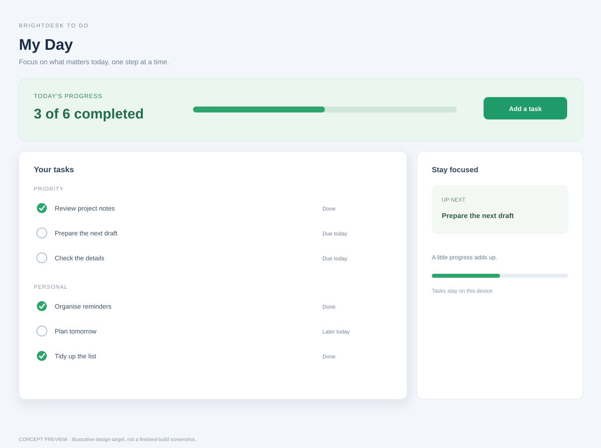

# Brightdesk To Do

 <strong>brightdesk</strong>

<strong>Manage daily tasks, due dates and personal priorities.</strong>

Select the preview to open the full-size artwork.

> **Concept artwork — not a screenshot.** The preview above is original Brightdesk design artwork, not a capture from the running desktop build. A genuine screenshot will be added only after the current product window has been launched and its primary workflow checked.

## Desktop implementation

This repository contains the desktop source for Brightdesk To Do. Electron hosts the desktop interface, the product module is maintained in `src/todo-service.js`, and the professional visual system is loaded from `src/design-system.css`. The preview above is concept artwork rather than a captured product screenshot.

- [Desktop interface](src/index.html)
- [Brightdesk To Do feature module](src/todo-service.js)
- [Brightdesk visual system](src/design-system.css)
- [Interface integration tests](tests/todo-ui-integration.test.js)
- [Shared Brightdesk Suite](https://github.com/connormolloy12/Brightdesk-suite)

## Shared Brightdesk design standard

Follow the local [approved design brief](docs/BRIGHTDESK_DESIGN.md) and canonical [Brightdesk visual standard](https://github.com/connormolloy12/Brightdesk-suite/blob/main/docs/BRIGHTDESK_VISUAL_STANDARD.md). The approved To Do accent is `#27834F`; preserve the shared navy/light shell and this product's original SVG identity.

## Cross-platform desktop packages

The approved cross-platform target is one Brightdesk interface and product scope on Windows, macOS and Linux. Each product must retain its approved icon and accent across those systems. Only operating-system integrations such as window chrome, native dialogs, keyboard conventions, permissions and packaging may vary.

| Platform | Configured package target |
| --- | --- |
| Windows | x64 NSIS installer (.exe) |
| macOS | Universal disk image (.dmg), package installer (.pkg) and archive (.zip) |
| Linux | x64 AppImage (.AppImage) and Debian package (.deb) |

These are configured build targets, not confirmation that installers are published or have passed native verification. Build and verify each package on its target operating system before describing it as available. Release checks must cover installation, first launch, upgrade, launch after upgrade and removal. Removing Brightdesk must not silently delete local project data.

The customer-facing release version and release approval are managed centrally by Brightdesk Office Suite. Publishing remains a separate manual action.

Build packages on their matching operating system with `npm run dist:win`, `npm run dist:mac` or `npm run dist:linux`. Verify the matching package with `npm run verify:desktop:win`, `npm run verify:desktop:mac` or `npm run verify:desktop:linux`.

## Current first-use workflows

- Create tasks with a title and optional notes.
- Edit tasks, set due dates and choose a priority.
- Mark tasks as important or add them to My Day.
- Complete, restore and delete tasks.
- Use My Day, Important, Planned, Tasks and Completed views.
- Search task titles and notes; keep task data saved on this device.

**Not included in this first version:** Operating-system notifications, recurring reminders, shared task lists, accounts and cloud sync.

## Implementation status

**Desktop source is committed to `main`.** This repository includes an Electron desktop shell, product modules, the shared visual system, Rust engine integration, build scripts and automated interface tests. The concept preview is not a screenshot from a running build. A platform desktop installer should only be described as ready after its build and verification checks pass.

## Design brief

See [docs/DESIGN_BRIEF.md](docs/DESIGN_BRIEF.md) for the screen designs, navigation and acceptance targets.

## Related project

[Brightdesk Office Suite](https://github.com/connormolloy12/Brightdesk-suite)
